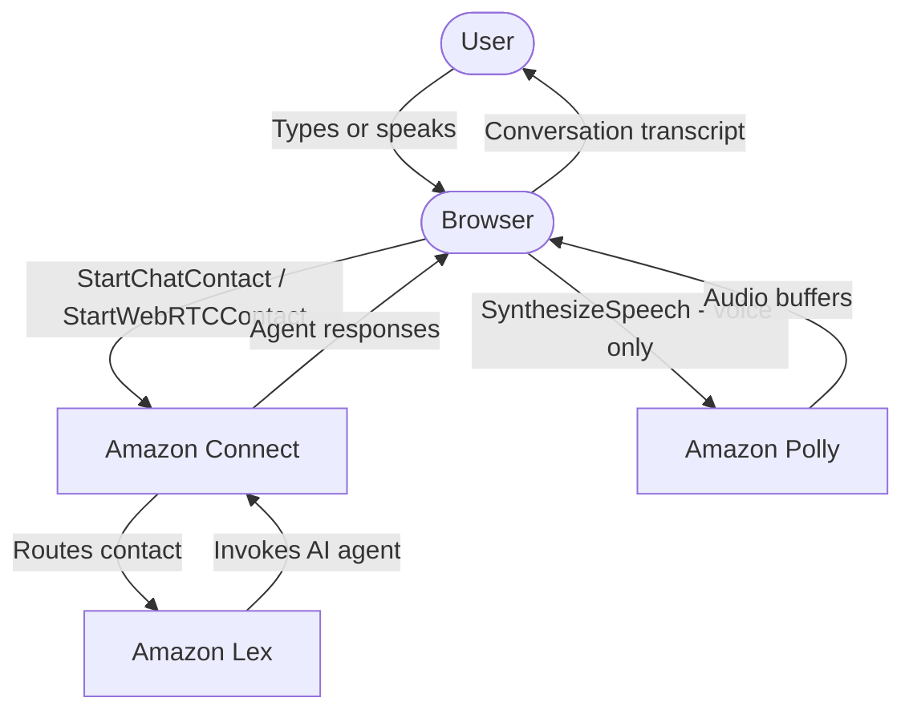
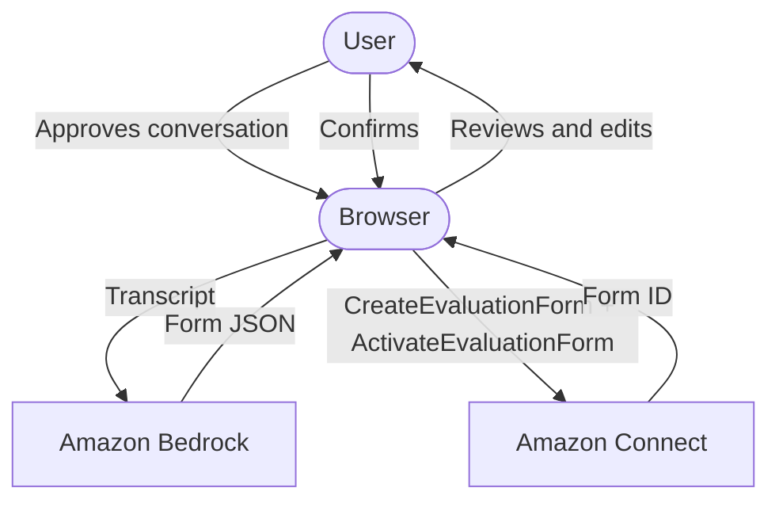
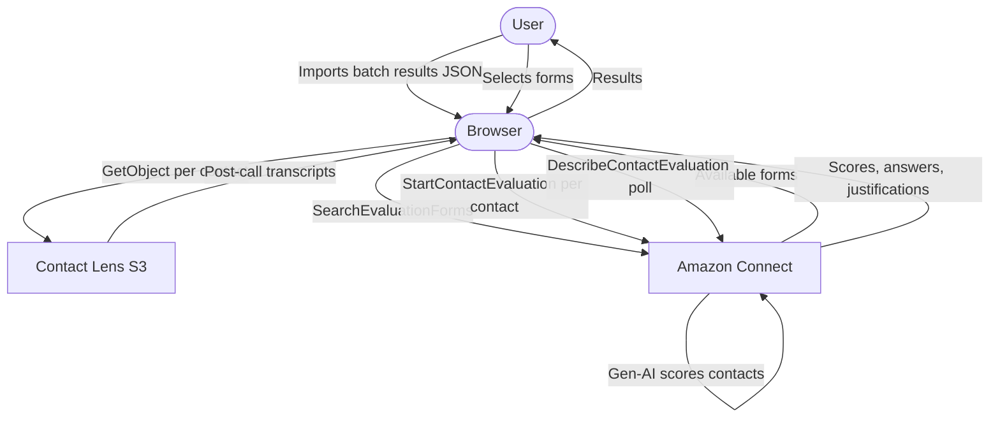
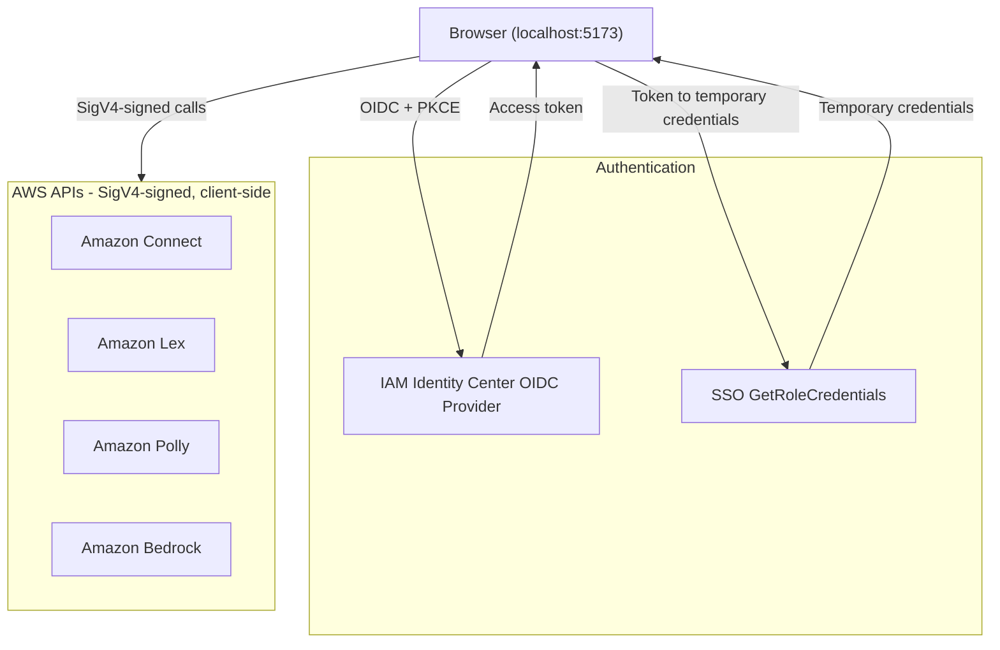

# AI Agents Lab for Amazon Connect

A browser-based tool for inspecting Amazon Connect AI agent execution traces, testing agents at scale, and evaluating response quality. No backend — the React SPA calls AWS APIs directly using temporary credentials obtained via IAM Identity Center OIDC.

## Features

### Span Waterfall Visualisation

Browse contacts by time range, resolve their Amazon Connect AI Agents sessions, and view the full execution trace as a waterfall timeline.

- Parent-child span relationships rendered as a Gantt chart
- Color-coded by type: `invoke_agent`, `inference`, `execute_tool`
- **Inference spans**: model ID, token usage (input/output/cache read/write), time to first token, temperature, finish reason, system prompt, input/output messages
- **Tool spans**: tool name, arguments, result, duration
- **Agent spans**: agent name, version, type, use case, total orchestration duration

### AI Agent Test Harness

Test Amazon Connect AI Agents agents interactively or with scripted conversations, over chat or voice.

#### Chat Testing

- **Manual mode**: type messages and see agent responses in real time
- **Script mode**: define multi-turn conversations in YAML and execute them automatically
- Per-turn latency tracking and full transcript capture
- Save any conversation as a reusable YAML script
- Generate a Connect evaluation form from a successful conversation (LLM-powered, with iterative refinement)

#### Voice Testing (WebRTC)

- **Manual mode**: push-to-talk voice calls via Amazon Chime SDK WebRTC
- **Script mode**: pre-generate customer audio with Amazon Polly, then stream it turn-by-turn to the agent
- Configurable Polly voice and engine (generative, neural, standard)
- Silence detection to determine when the agent has finished speaking
- Per-turn latency metrics (time from audio send to first agent audio)

#### YAML Test Script Format

```yaml
name: "Booking flow — happy path"
turns:
  - customer: "I'd like to book a flight"
  - customer: "London to Paris, next Friday"
    variations:           # optional: alternative phrasings (see Batch Variation Generation)
      - "I need a flight from London to Paris next Friday"
      - "Can you book London to Paris for next Friday?"
```

- Script name: 1–200 characters
- Turns: 1–50 per script
- Customer utterance: 1–1024 characters

### Batch Variation Generation

Enrich a script with automatically generated paraphrases for each customer turn before running a batch. During batch execution each iteration randomly samples one utterance per turn from the original + variations pool, testing how robustly the agent handles natural language diversity.

1. Load a YAML script and switch to **Batch** mode
2. Set a **variation count** (1–20 per turn) and **temperature** (0.0–1.0)
3. Click **Generate variations** — a single Bedrock call (Claude Haiku) enriches all turns using the full conversation context
4. Review or edit the updated YAML, then run the batch as usual
5. Export the enriched script to reuse in future sessions

Requires `bedrock:InvokeModel` permission for `us.anthropic.claude-haiku-4-5-20251001-v1:0` (or the equivalent model in your region — configure the model ID via **Settings → General** in the app).

### Batch Test Execution

Run the same script at scale to measure reliability and latency.

- Execute 1–1000 iterations with configurable concurrency (1–50)
- Works for both chat and voice channels
- Live progress bar, status counters, and elapsed time
- Adjust concurrency on the fly during execution
- Latency distribution histogram with auto-sized buckets and p50/p95 indicators
- Aggregate stats: completion counts by termination reason, average/p50/p95 latency
- Sortable, filterable, paginated results table
- Drill into any iteration's full transcript
- Export results as JSON for offline analysis or evaluation
- Stop All with graceful termination and result preservation

### Evaluations

Assess the quality of agent responses from batch test runs using Amazon Connect's native gen-AI evaluation capability.

**Step 1 — Create an evaluation form** (Testing page, one-time per scenario):
1. Have a successful manual chat conversation with your agent
2. Click **⋮ → Create evaluation form**
3. An LLM analyses the conversation and generates a structured form with sections and questions focused on observable milestones (what the agent needed to accomplish, and how it communicated)
4. Review and edit the form in the inline code editor, then click **Deploy** to create and activate it in your Connect instance

Forms are tagged automatically and appear in the evaluation form selector.

**Step 2 — Evaluate a batch run** (Evaluations page):
1. Import a batch results JSON file — hydration fetches the Contact Lens post-call transcript for each contact automatically
2. Select one or more evaluation forms
3. Click **Evaluate all** — Connect's gen-AI scores each contact against every selected form

Per-contact output:
- **Score**: 0–100%
- **Verdict**: pass (≥90%) / partial (50–89%) / fail (<50%)
- **Per-question results**: the answer (Yes/No/N/A), score, and a written justification from the evaluator explaining its reasoning

Summary metrics: pass rate, average score, score distribution, per-question pass rates.

Multiple forms can be run in a single pass — useful for evaluating outcome quality and communication style independently.

### Settings

- **General** (`/settings`): Contact Lens analytics language (BCP-47 locale, e.g. `en-US`, `fr-FR`)
- **Evaluations** (`/settings/evaluations`): Bedrock model ID used for evaluation form generation
- **Permissions** (`/settings/permissions`): verify your IAM permissions against all required actions, grouped by feature area

### Workspace Selection

On first use, the app discovers all Connect instances across regions and lists Amazon Connect AI Agents assistants. You select an instance and assistant — this selection is persisted across sessions and can be changed from the top navigation at any time.

## Prerequisites

- **Node.js 18+**
- **AWS CLI v2** configured with credentials that can deploy CloudFormation and Lambda
- An AWS account with:
  - **IAM Identity Center (IDC) enabled** — required for authentication
  - At least one Amazon Connect instance with Amazon Connect AI Agents (Wisdom) configured

## IAM Identity Center Requirement

This tool authenticates users via IAM Identity Center's OIDC Authorization Code flow with PKCE. IDC is used to:
1. Authenticate the user (sign-in via the IDC portal)
2. Obtain temporary AWS credentials (via SSO role credentials) to call Connect APIs from the browser

If you don't have IDC enabled:
1. Open the [IAM Identity Center console](https://console.aws.amazon.com/singlesignon)
2. Enable Identity Center in your chosen region
3. Create at least one user (or connect an external identity source like Okta or Azure AD)
4. Note your **AWS access portal URL** — format: `https://d-XXXXXXXXXX.awsapps.com/start`

This URL is the `identityCenterStartUrl` parameter used during deployment.

> **Important:** After enabling IDC, you must assign at least one AWS account and permission set to your user. The app authenticates via IDC, then asks IDC "which accounts and roles can this user access?" to obtain temporary AWS credentials for calling Connect APIs. If no account is assigned, IDC has nothing to offer — the user is authenticated (identity is confirmed) but not authorised (no permissions to act on any account). To fix this, go to **IAM Identity Center → Multi-account permissions → AWS accounts**, select the target account, and assign your user (or group) with a permission set that includes the [end-user permissions](#end-user-permissions) listed below.

## Deployment

### Quick Start (full deploy)

```bash
./scripts/deploy.sh all -c identityCenterStartUrl=https://d-XXXXXXXXXX.awsapps.com/start
```

This single command:
1. Installs all dependencies (app + CDK infra)
2. Bootstraps CDK if needed
3. Deploys infrastructure (OIDC client registration via Lambda)
4. Populates `.env` with stack outputs

After deployment, run `npm run dev` to start the app locally at `http://127.0.0.1:5173`.

### Deploy Parameters

| Parameter | Required | Description |
|-----------|----------|-------------|
| `identityCenterStartUrl` | Yes | Your IDC portal URL (`https://d-XXXXXXXXXX.awsapps.com/start`) |
| `identityCenterRegion` | No | Only needed if IDC is in a different region than the deployment target |
| `--profile` | No | AWS CLI profile to use |
| `--stack` | No | Stack name (default: `AIAgentsLabStack`) |

### Deploy Commands

| Command | Description |
|---------|-------------|
| `./scripts/deploy.sh all` | Full deploy: infra + env setup |
| `./scripts/deploy.sh infra` | Deploy CDK infrastructure only |
| `./scripts/deploy.sh env` | Update .env from stack outputs |
| `./scripts/deploy.sh outputs` | Print all stack outputs |
| `./scripts/deploy.sh start` | Install deps + start local dev server |

### Examples

```bash
# Deploy with IDC in a different region
./scripts/deploy.sh all \
  -c identityCenterStartUrl=https://d-XXXXXXXXXX.awsapps.com/start \
  -c identityCenterRegion=eu-central-1 \
  --profile my-profile

# Use an existing OIDC client (skip client registration)
./scripts/deploy.sh all \
  -c existingOidcClientId=YOUR_CLIENT_ID \
  -c existingOidcIssuerUrl=https://oidc.eu-central-1.amazonaws.com \
  -c existingOidcClientSecret=YOUR_CLIENT_SECRET
```

### Deployer Permissions

The AWS credentials used to run `deploy.sh` need:

```
cloudformation:*          (CDK stack management)
lambda:*                  (custom resource for OIDC registration)
iam:*                     (Lambda execution role)
sts:AssumeRole            (CDK bootstrap roles)
sso-oauth:*               (OIDC client registration via Lambda)
```

These are broad permissions needed only for deployment. End users don't need any of these.

## End-User Permissions

The signed-in user's IDC permission set needs access to the following APIs, depending on which features they use.

### Core (required)

```json
{
  "Effect": "Allow",
  "Action": [
    "connect:ListInstances",
    "connect:DescribeInstance",
    "connect:SearchContacts",
    "connect:DescribeContact",
    "qconnect:ListAssistants",
    "qconnect:SearchSessions",
    "qconnect:ListSpans",
    "wisdom:ListAIAgents"
  ],
  "Resource": "*"
}
```

### Testing — Chat

```json
{
  "Effect": "Allow",
  "Action": [
    "connect:StartChatContact",
    "connectparticipant:CreateParticipantConnection",
    "connectparticipant:SendMessage",
    "connectparticipant:DisconnectParticipant"
  ],
  "Resource": "*"
}
```

### Testing — Voice

```json
{
  "Effect": "Allow",
  "Action": [
    "connect:StartWebRTCContact",
    "polly:DescribeVoices",
    "polly:SynthesizeSpeech"
  ],
  "Resource": "*"
}
```

### Testing — Infrastructure Setup (one-time)

The test harness auto-provisions a Lex bot and contact flow on first use. This requires:

```json
{
  "Effect": "Allow",
  "Action": [
    "lex:ListBots",
    "lex:DescribeBot",
    "lex:ListBotAliases",
    "lex:ListBuiltInIntents",
    "lex:CreateBot",
    "lex:CreateBotLocale",
    "lex:CreateIntent",
    "lex:BuildBotLocale",
    "lex:DescribeBotLocale",
    "lex:CreateBotVersion",
    "lex:CreateBotAlias",
    "lex:TagResource",
    "connect:AssociateBot",
    "connect:ListContactFlows",
    "connect:CreateContactFlow",
    "connect:UpdateContactFlowContent"
  ],
  "Resource": "*"
}
```

### Batch Test Execution — Variation Generation

```json
{
  "Effect": "Allow",
  "Action": [
    "bedrock:InvokeModel"
  ],
  "Resource": "*"
}
```

### Evaluations

```json
{
  "Effect": "Allow",
  "Action": [
    "connect:DescribeContact",
    "connect:CreateEvaluationForm",
    "connect:ActivateEvaluationForm",
    "connect:SearchEvaluationForms",
    "connect:StartContactEvaluation",
    "connect:DescribeContactEvaluation",
    "connect:ListContactEvaluations",
    "s3:GetObject",
    "s3:ListBucket",
    "bedrock:InvokeModel"
  ],
  "Resource": "*"
}
```

`bedrock:InvokeModel` is required for evaluation form generation (the LLM call that analyses your conversation and produces the form). Evaluation scoring itself is handled by Connect's native gen-AI capability — no Bedrock call required from the app during scoring.

### Permissions Checker

```json
{
  "Effect": "Allow",
  "Action": [
    "iam:SimulatePrincipalPolicy"
  ],
  "Resource": "*"
}
```

All permissions can be scoped to specific instance/assistant/model ARNs for tighter control.

## Local Development

### With mock auth (no IDC needed)

```bash
cp .env.example .env
# VITE_AUTH_BYPASS=true is already set in .env.example
npm install
npm run dev
```

You'll still need real AWS credentials configured via the AWS CLI to call Connect APIs.

### With real auth (after infra is deployed)

```bash
./scripts/deploy.sh env    # pulls stack outputs into .env
npm run dev                # starts dev server at http://127.0.0.1:5173
```

## Data Flow

### Testing flow



### Evaluation form creation flow



### Evaluation scoring flow



## Architecture



No backend server — the app calls AWS APIs directly from the browser using temporary credentials obtained via IAM Identity Center OIDC (with PKCE). Credentials auto-refresh before expiry.

## Tech Stack

- React 18 + TypeScript + Vite 6 (SWC)
- Cloudscape Design System (AWS UI components)
- AWS SDK for JavaScript v3 (browser)
- Amazon Chime SDK JS (WebRTC voice)
- CDK v2 (infrastructure as code)
- Vitest + fast-check (testing)

## Troubleshooting

### `Access Denied: kms:GenerateDataKey` when opening the Testing page

**Symptom:** Navigating to the Testing page shows an Access Denied error referencing `kms:GenerateDataKey`, even though the user has full admin permissions on the account.

**Cause:** The Amazon Connect AI Agents assistant is configured with a customer-managed KMS key (CMK) for encryption at rest. KMS uses dual authorization — both the caller's IAM policy *and* the key policy must allow access. If the CMK's key policy doesn't include the account root principal (`arn:aws:iam::<account>:root`), no IAM policy — not even `AdministratorAccess` — can authorize key usage.

This typically happens when:
- The assistant was created with a CMK whose key policy only grants access to the Wisdom/QConnect service, not to account principals
- The CMK is in a different account (cross-account key)

**Fix:** Add the account root (or the specific calling role) to the CMK's key policy:

```json
{
  "Sid": "Allow account principals via IAM",
  "Effect": "Allow",
  "Principal": { "AWS": "arn:aws:iam::<account-id>:root" },
  "Action": ["kms:GenerateDataKey", "kms:Decrypt"],
  "Resource": "*"
}
```

**To identify the key:** call `GetAssistant` on the affected assistant — the response includes `serverSideEncryptionConfiguration` with the CMK ARN. Then inspect that key's policy in the KMS console.

### `No AWS accounts are assigned to your Identity Center user`

**Symptom:** Sign-in succeeds but the app displays "No AWS accounts are assigned to your Identity Center user."

**Cause:** The IDC user has no account + permission set assignment. Authentication (confirming identity) succeeded, but there are no AWS accounts the user is authorized to access, so the app cannot obtain temporary credentials.

**Fix:** In IAM Identity Center → Multi-account permissions → AWS accounts, assign the user (or their group) to the target account with a permission set that includes the required [end-user permissions](#end-user-permissions).
